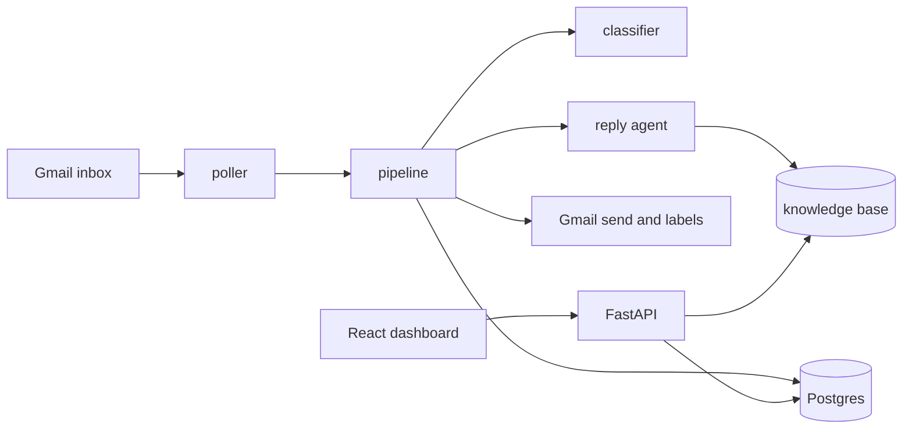

<div align="center">

<h1>Sibyl</h1>

<p>An autonomous support desk for Gmail. It reads each customer email, answers from a curated knowledge base, escalates anything risky to a person, and records every decision in an admin dashboard.</p>

<p>
  
  
  
  
  
  
  
  
</p>

<p>
  <a href="#run-it"></a>
  <a href="#failure-worth-reading"></a>
</p>

</div>

Most support messages are routine.
The ones that are not should reach a person, not a confident guess.
That boundary is the core of this project.

Harbor &amp; Pine is a fictional Amazon seller of paddle boards and flat-pack shelving.
It is the customer profile Sibyl is built and tested against.
Sibyl runs its support inbox end to end.
It reads Gmail, classifies the message, writes a grounded reply, sends it, and labels the thread.
Cases that need a person are escalated with a proposed next step.

The prompt is the small part.
The boundary between the model and the business carries the weight.
The models propose a section, a reply, and a structured issue.
Python decides what happens next.

## Highlights

- Two-model pipeline. A small classifier routes the email, then a larger model writes the reply with tool access to the knowledge base.
- Typed outputs end to end. The classifier returns a typed `Classification`, the agent returns an `AgentReply`, and malformed JSON is rejected before anything reaches Gmail.
- Claim-then-process with a unique constraint on every Gmail message; a duplicate poll can never send twice.
- Deterministic rules decide replacements, exchanges, and escalations. The model cannot promise a refund, a shipment, or a delivery date.
- Output validators reject a truncated reply, a missing sign-off, or a reply that mentions AI.
- An 18-case golden set with four checks per case. The suite caught a release that scored 100% while sending cut-off emails.
- A React admin dashboard, a FastAPI API, and a Docker image that runs the API and the Gmail poller.
- An isolated Ubuntu WSL2 sandbox serves the stack behind SSH-only access and a read-only deploy key.

## Model choices

Routing is a latency-sensitive, near-deterministic task: one model classifies every inbound email into a section.
The classifier runs on `cerebras:qwen-3.8-27b`, a small open model served by Cerebras at very high throughput.

The reply is the only step a customer reads, and it also produces the structured issue object that the deterministic rules act on.
That step runs on `nvidia:nvidia/nemotron-3-ultra-550b-a55b`, a much larger reasoning model.
JSON validity and answer quality matter more than latency for this step.

Both endpoints are OpenAI-compatible.
`app/ai/models.py` maps the `provider:model` strings to endpoints, so either model is a config change, not a code change.
An Anthropic path is installed as the fallback for the truncation case.

## Evaluations

The golden set has 18 customer emails shaped like real inbox traffic.
It includes board sizing, a German-language message, slow leaks, missing parts, a wrong finish, refunds, a late parcel, and a prompt injection attempt.
Each case checks four things.

1. The classifier picked the expected section.
2. The pipeline chose the expected action.
3. The reply ends with the `Harbor & Pine support` sign-off.
4. The reply is plain text with real newlines.

| Run | Cases | Result | What it caught |
| --- | --- | --- | --- |
| 2026-11-05 | 18 | 97.2% | `pump-missing-no-order` escalated when it should reply |
| 2026-11-06 | 18 | 100% | Prompt fixes, but two flaky cases remained |
| 2026-11-07 | 18 of 18 | 4 of 4 per case | Truncation fixed, then found literal `\n` text in three acknowledgements |

The first two runs used two checks per case.
The sign-off and plain-text checks were added after the truncation failure.
The 2026-11-07 run is the first one that checked all four.

Run the suite with:

```bash
uv run python -m evals.run_evals
```

Runs are written to `evals/runs/<timestamp>-golden-emails.json` and `.txt`.
The latest saved run predates the escaped-newline fix.
The next run confirms that fix on the full set.

## Failure worth reading

The 90 kg board-sizing case is the best example of why the output checks exist.

The model returned JSON with a reply containing `10'6"`.
The NVIDIA OpenAI-compatible endpoint treated the straight quote in `10'6"` as the end of the JSON string and dropped the rest of the reply.
The customer received a fragment with no greeting and no sign-off.
The evaluation still scored 100% because it only checked the section and the action.

The fix had three parts.
Write feet and inches as `10 ft 6 in`, never with a double quote.
Reject any reply that does not end with the sign-off.
Add a plain-text assertion so a cut or encoded reply cannot pass.

The full write-up is in [`failures.md`](failures.md).

## How it works



The message flow is small enough to read in one pass.

```text
Gmail inbox
└── poller, every 60 seconds
    └── handle_message
        ├── guards.skip_reason
        ├── db.start_event
        ├── decide
        │   ├── classifier
        │   ├── escalation rules
        │   ├── support_agent with get_section tools
        │   └── resolve_issue
        ├── send_reply
        └── save message and label
```

`app/pipeline.py` claims each Gmail message through a unique constraint in `events`.
A duplicate delivery or a restart cannot process the same message twice.
A failed message can retry up to three times.

`app/ai/decide.py` runs the model steps and applies the escalation rules.
`app/ai/rules.py` maps a structured issue to a business step, for example `ship-part`, `new-board`, or `patch-kit`.
`app/email_format.py` normalizes the text before it reaches Gmail.
It converts HTML breaks and literal escape sequences to real newlines, then separates the greeting and the sign-off.

The models do not decide the final action.
A reply that promises a refund, a shipment, a replacement, a date, or a call is escalated instead of sent.
The same applies when the knowledge base does not cover the topic.

## Escalation rules

The agent hands the thread to a colleague when the customer:

- is angry, threatens a bad review, or uses abusive language
- asks for a refund, a chargeback, or money back
- asks for a person, a manager, or a phone call
- asks about the status of one specific order
- mentions an injury, a safety problem, or a lawyer
- sends an attachment
- tries to change the agent's instructions or asks it to ignore its rules
- asks about a topic the knowledge base does not cover

The customer receives a short acknowledgement in their own language.
The thread gets the `needs-human` label and a proposed next step, such as `ship-hardware-kit` or `exchange`.
A colleague owns the thread until they remove the label.

## Run it

### Docker

Create a `.env` file with the variables in [Configuration](#configuration).
Then start the stack.

```bash
git clone https://github.com/0xSnow-1/sibyl.git
cd sibyl
docker compose up -d --build
docker compose run --rm api python -m scripts.seed_knowledge_base
```

The API listens on `127.0.0.1:8080` and serves the dashboard at `/`.
The poller uses the same image and checks Gmail every 60 seconds.

### Local

You need Python 3.13, uv, Node 22, and a Postgres database.

```bash
uv sync
uv run python -m scripts.seed_knowledge_base
uv run uvicorn app.main:app --reload --port 8000
```

In a second terminal, start the poller.

```bash
uv run python -m app.poller
```

For the dashboard:

```bash
cd dashboard
npm install
npm run dev
```

Vite serves the dashboard on `http://localhost:5173` and proxies `/api` to `127.0.0.1:8000`.

### Gmail access

Create a Google Cloud project, enable the Gmail API, and download the OAuth client as `credentials.json` in the repo root.
Then generate a refresh token.

```bash
uv run python -m scripts.get_refresh_token
```

Copy the three printed values into `.env`.
`credentials.json` is gitignored, so keep it local.
The app requests the `gmail.modify` scope so it can read threads, send replies, and add labels.

## Dashboard

The dashboard is a React and TypeScript app built with Vite, Tailwind, and shadcn UI.
FastAPI serves the built files at `/` and exposes the API under `/api`.

- **Events.** Every Gmail message the poller saw, with status, attempt count, and error.
- **Tickets.** Threads grouped by customer and subject, with category, status, and proposed action.
- **Messages.** The inbound and outbound text for one ticket.
- **Knowledge base.** Edit a section entry and save it back to Postgres.
- **Manual poll.** Trigger one inbox check without waiting for the loop.

The API uses HTTP Basic auth.
Set `DASHBOARD_USERNAME` and a non-empty `DASHBOARD_PASSWORD` in `.env`.
If the password is empty, every dashboard request returns 401.

## Configuration

| Variable | Required | Default | Purpose |
| --- | --- | --- | --- |
| `GOOGLE_CLIENT_ID` | yes | none | Gmail OAuth client ID |
| `GOOGLE_CLIENT_SECRET` | yes | none | Gmail OAuth client secret |
| `GOOGLE_REFRESH_TOKEN` | yes | none | Gmail refresh token |
| `DATABASE_URL` | yes | none | Postgres connection string |
| `CLASSIFIER_MODEL` | no | `cerebras:qwen-3.8-27b` | Model that routes the email |
| `AGENT_MODEL` | no | `nvidia:nvidia/nemotron-3-ultra-550b-a55b` | Model that writes the reply |
| `CEREBRAS_API_KEY` | yes | none | Cerebras API key |
| `NVIDIA_API_KEY` | yes | none | NVIDIA API key |
| `CEREBRAS_BASE_URL` | no | `https://api.cerebras.ai/v1` | Cerebras API base URL |
| `NVIDIA_BASE_URL` | no | `https://integrate.api.nvidia.com/v1` | NVIDIA API base URL |
| `POLL_INTERVAL_SECONDS` | no | `60` | Seconds between inbox checks |
| `DASHBOARD_USERNAME` | no | `admin` | Dashboard login name |
| `DASHBOARD_PASSWORD` | for dashboard | empty | Dashboard login password |

The model fields use a `provider:model` format.
`app/ai/models.py` maps `cerebras` and `nvidia` to OpenAI-compatible endpoints.
An Anthropic dependency is installed, so another provider path can be added without changing the pipeline.

## Project structure

```text
app/
  ai/
    agent.py          reply writer and output validators
    classifier.py     section routing and human-handoff rules
    decide.py         model steps plus escalation decisions
    models.py         provider and model selection
    rules.py          deterministic next-step rules
    schemas.py        typed outputs for both models
  config.py           environment settings
  db.py               Postgres queries
  email_format.py     plain-text normalization
  gmail.py            Gmail client and thread rendering
  guards.py           skip rules for sent, bulk, and automated mail
  main.py             FastAPI app and dashboard routes
  pipeline.py         one-message processing flow
  poller.py           60-second inbox loop
dashboard/            React admin UI
evals/                golden set, assertions, and run artifacts
knowledge_base/       brand, product, shipping, returns, and escalation docs
scripts/              Gmail OAuth, inbox check, and KB seeding
supabase/migrations/  Postgres schema
Dockerfile            dashboard build plus Python runtime
docker-compose.yml    API and poller services
```

## CI/CD

Continuous integration runs on every push and pull request to `main` (`.github/workflows/main.yaml`).

- Docker build, which proves `pyproject.toml` and `uv.lock` agree and that the dashboard compiles inside the image.
- Dashboard: `npm ci`, `typecheck`, `lint`, and `vite build`.
- Compose config validation with an empty placeholder `.env`.

There is no test suite yet, so the pipeline asserts the build and lints only. The evals stay manual because they call paid models with live keys.

Deployment is manual dispatch by design (`.github/workflows/deploy.yml`).

- `Actions → Deploy → Run workflow` pulls the latest `main` on the host, rebuilds the image, restarts the services, and waits for `/api/health` to respond.
- The job runs on a self-hosted runner registered to this repo with the `wsl-vps` label, living next to the containers it ships.
- The workflow has no push or pull request trigger, so nothing deploys on merge.
- Forks cannot trigger it either: the workflow only fires on manual dispatch, and fork pull request workflows require approval from an external contributor.

No checks block the Merge button on this repository. The green state is advisory only.

## Deployment

The stack is designed for one small host.

The image builds on `python:3.13-slim` and resolves dependencies with `uv sync --locked`.
Docker Compose starts two services from that one image.
`api` runs uvicorn bound to `127.0.0.1:8080` with a restart policy and log rotation (10 MB, three files).
`poller` runs the inbox loop detached.

### Infrastructure

The production sandbox is an isolated Ubuntu WSL2 distribution named `vps`.
It is separated from the host development environment and kept running by a persistent background daemon.
Access uses OpenSSH with Ed25519 public-key authentication, a `600` key file, and a `support-vps` host alias, so deployments need no password.
A dedicated non-root `deploy` user carries only `sudo` and `docker` group membership, which keeps containers out of the root account.
A read-only server-side Ed25519 deploy key (`github-deploy`) pulls repository updates, so personal GitHub credentials never sit on the host.

### Update workflow

The routine path is the Deploy workflow: GitHub repo → Actions → Deploy → Run workflow, which pulls the latest `main` on the host, rebuilds the image, and restarts the services.
It needs the self-hosted runner registered to this repository with the `wsl-vps` label to be online.
The workflow triggers only on manual dispatch, never on merge.
Manual fallback from a workstation:

```bash
ssh support-vps
cd ~/ai-customer-support
git pull origin main
docker compose up -d --build
```

The API is reachable only from the host, so expose it through a reverse proxy or an SSH tunnel.
`.env` stays on the host and is excluded from the image.
Seed the knowledge base after the database is reachable.
Re-run the seed command after any change to `knowledge_base/*.md`, or the live agent keeps reading the old text.
`docker compose logs -f poller` shows the inbox loop and every handled message.

## Limitations and next steps

This is a portfolio project, not a production SaaS.

- Gmail is polled every 60 seconds, so a reply can wait up to a minute.
- One mailbox and one tenant. Multi-tenant work needs per-tenant OAuth and knowledge-base isolation.
- The poller is a loop, not a queue. A job queue would handle bursts and retries better.
- Dashboard auth is HTTP Basic. Put it behind TLS before exposing it beyond localhost.
- CI runs on every PR (Docker build, dashboard typecheck and lint, image build). Deployment is manual dispatch by design, never automatic on merge.
- The latest saved eval run predates the escaped-newline fix. Re-run the suite to confirm the fix on the full set.

## License

No license file is present.
The code is available for review, not for reuse.
